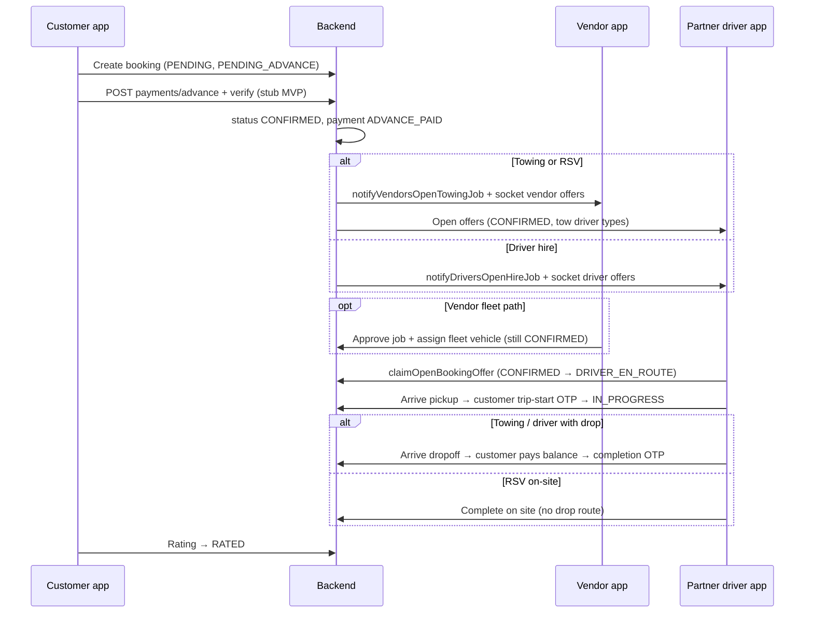

# Booking dispatch, lifecycle & customer UI

Canonical reference for **who gets which job**, **status meaning**, and **customer screens**.  
Verified against backend on branch `v2.0.1-cleanup` (not legacy `Booking` collection).

Related: [`CLIENT_USER_FLOWS.md`](CLIENT_USER_FLOWS.md) (journeys), [`CLIENT_DOC_VS_BUILD.md`](CLIENT_DOC_VS_BUILD.md) (spec vs build).

---

## 1. Three customer products → one backend model

| What the customer books | ID prefix | Created via | Stored as | Who is notified after advance paid |
|-------------------------|-----------|-------------|-----------|-------------------------------------|
| **Towing** (instant / scheduled / emergency UI) | `TOW-*` | `POST /api/v1/bookings/towing` | `TowingBooking` | **Vendors** (`notifyVendorsOpenTowingJob`) + tow-capable **drivers** see open offers |
| **Driver hire** (part-time / full-time / etc.) | `DRV-*` | `POST /api/v1/bookings/driver` | `DriverBooking` | **Independent drivers** (`notifyDriversOpenHireJob` → `emitDriverOffersUpdated`) |
| **Roadside on-site** (battery, tyre, fuel, minor repair) | `RSV-*` | `POST /api/v1/bookings/roadside` → `createRoadsideOnSiteBooking` | `TowingBooking` (pickup = drop, `assistLabel` set) | **Same as towing** (vendor notify + tow-driver offers) |
| **Roadside “towing with drop”** (slug `towing_*`) | `TOW-*` | `POST /api/v1/bookings/roadside` redirects to `createBooking` | `TowingBooking` | Same as towing |

**Not the same pool:** driver-hire jobs do **not** go to vendor towing queues. Towing and RSV roadside **do** share the vendor + tow-driver pipeline.

**Driver eligibility (backend):** `driverAssignment.ts`  
- Towing / RSV: `TOWING_DRIVER_TYPES` = `Tow Driver`, `Full-Time` (includes vendor fleet drivers).  
- Driver hire: `DRIVER_SERVICE_TYPES` = `Full-Time`, `Part-Time` (independent feed filtered by `selfDriverCategory`).

---

## 2. End-to-end lifecycle (all service bookings)

---

## 3. Unified booking status (backend truth)

Defined in `backend/src/services/src/bookingStatusConstants.ts`.

| Status | Meaning | Customer must not read as |
|--------|---------|---------------------------|
| `PENDING` | Created; **advance not paid** | “Partner confirmed” |
| `CONFIRMED` | Advance paid; **matching partners** | “Driver already coming” |
| `DRIVER_ASSIGNED` | Partner linked; may still need **accept** | Same as en route |
| `DRIVER_EN_ROUTE` | Partner accepted; heading to pickup | — |
| `DRIVER_ARRIVED` | At pickup; **trip-start OTP** applies | — |
| `IN_PROGRESS` | Trip / tow / on-site work started | — |
| `COMPLETED` | Partner finished; rate / receipt | — |
| `RATED` | Customer rated | Terminal |
| `CANCELLED` | Cancelled (fee/refund rules apply) | Terminal |

**Payment status (parallel field):** `PENDING_ADVANCE` → `ADVANCE_PAID` → `PENDING_FINAL` → `FULLY_PAID` (`BOOKING_PAYMENT_STATUSES`).

Customers cannot jump status via API; drivers operate en route → arrived → in progress → completed (`assertActorMayTransition`).

---

## 4. Dispatch mechanics (backend)

| Step | Towing + RSV | Driver hire |
|------|----------------|-------------|
| After create | `PENDING`, notify customer to pay advance | Same |
| After advance verify | `CONFIRMED`; `notifyVendorsOpenTowingJob` + `emitVendorOffersUpdated` | `CONFIRMED`; `notifyDriversOpenHireJob` + `emitDriverOffersUpdated` |
| Vendor approves (optional) | Sets `vendorId` + fleet vehicle; stays `CONFIRMED` until driver claims | Rare on open market; fleet path exists in assignment helpers |
| Driver accepts | `claimOpenBookingOffer`: `CONFIRMED` → `DRIVER_EN_ROUTE` | Same pattern on `DriverBooking` |
| Admin override | `adminBookings.assignVendor`, assign driver endpoints | Same collections |

Open offers: `listOpenOffersForDriver` reads `CONFIRMED` towing + driver bookings within radius (~50 km default).

---

## 5. OTP & payment at pickup / drop

| OTP | When exposed to customer | Backend gate |
|-----|---------------------------|--------------|
| **Trip-start** | `DRIVER_ARRIVED` (customer list + track) | `customerTripOtp()` — partner must be en route / arrived / in progress |
| **Completion** | After drop (towing/driver with drop) | `customerCompletionOtp()` requires `arrivedAtDropoffAt` **and** `paymentConfirmedByCustomer` |

**Roadside RSV:** pickup = drop; no “To” route. Work completes on site; completion OTP only if backend dropoff/payment path runs (often flat fare, less drop UI).

**Customer UI today**

| Stage | Towing | Driver hire | Roadside |
|-------|--------|-------------|----------|
| Advance | `BookingPaymentScreen` (stub verify) | Same | Same |
| Waiting | `BookingsScreen` + `bookingFlowCopy.ts` | Same | Same + `roadsideHelpUi.ts` on `RoadsideHelpOnWayScreen` |
| Live trip | `TowingTrackScreen` / `TowingDriverOnWayScreen` — `formatLiveTrackingSummary` + `track*` helpers in `bookingFlowCopy.ts` | Same | `RoadsideHelpOnWayScreen` |
| Balance | `DropoffPaymentModal` (when tracking exposes dropoff + payment flags) | Same where drop exists | Usually on-site; may skip drop modal |

---

## 6. Customer copy (avoid misleading UI)

Implementation: `customer application/src/utils/bookingFlowCopy.ts` + `ActiveBookingCard.tsx`.

- Do **not** show green “Confirmed” alone while still matching partners — use e.g. “Confirmed · finding tow vendor”.
- **Roadside:** “Finding partner” = vendor/tow network, not driver-hire pool.
- **Driver hire:** “Finding driver” = independent/part-time/full-time offers.
- Full addresses on cards: `formatBookingStopAddress` / `bookingApi.toBookingLocation` (not shortened “Pinned on map” when address exists).

---

## 7. Partner & admin surfaces

| Actor | Towing / RSV | Driver hire |
|-------|--------------|-------------|
| **Vendor** | Jobs list / approve / assign fleet (`approveVendorBookingOffer`) | Not primary channel |
| **Driver** | Offers for tow drivers + fleet claims | Offers for `Part-Time` / `Full-Time` independents |
| **Admin** | Assign vendor, assign driver, force cancel | Same APIs on `DriverBooking` |

---

## 8. APIs (customer-facing)

| Action | Method & path |
|--------|----------------|
| Create towing | `POST /api/v1/bookings/towing` |
| Create driver hire | `POST /api/v1/bookings/driver` |
| Create roadside | `POST /api/v1/bookings/roadside` |
| Roadside availability | `GET /api/v1/bookings/roadside/availability` |
| List my bookings | `GET /api/v1/bookings` (combined towing + driver) |
| Towing tracking | `GET /api/v1/bookings/towing/:id/tracking` |
| Driver tracking | `GET /api/v1/bookings/driver/:id/tracking` |
| Advance pay | `POST /api/v1/payments/advance` + verify (stub in MVP) |
| Cancel preview / cancel | `GET/POST .../cancel-preview`, `.../cancel` per type |

---

## 9. Spec vs build (honest gaps)

| Area | Built | Not built / stub |
|------|--------|-------------------|
| Create + dispatch notify | Yes (CONFIRMED broadcast) | Real payment gateway |
| Vendor approve + driver claim | Yes | Guaranteed SLA / auto-assign |
| Status + OTP rules | Yes in API | Customer track/detail/history use `bookingFlowCopy`; live map polish still partial |
| Live map | Partial socket | Admin live map; full customer polyline polish |
| Towing “instant vs emergency” | UI labels | Not separate backend product flags |
| Driver “four products” | Generic `driverServiceType` on some paths | Not all home cards map 1:1 |
| Legacy `Booking` collection | — | Admin reports may still reference; mobile uses TowingBooking + DriverBooking only |

For scores and module breakdown see [`CLIENT_DOC_VS_BUILD_SHORT.md`](CLIENT_DOC_VS_BUILD_SHORT.md).

---

## 10. Code index

| Concern | Location |
|---------|----------|
| Roadside router | `backend/src/services/src/bookings/roadsideBooking.ts` |
| Towing + RSV create | `backend/src/services/src/bookings/towingBooking.ts` |
| Driver create | `backend/src/services/src/bookings/driverBooking.ts` |
| Offers + claim | `backend/src/services/src/bookings/driverAssignment.ts` |
| Notify vendor/driver | `backend/src/services/src/bookingNotifications.ts` |
| Status + payment enums | `backend/src/services/src/bookingStatusConstants.ts` |
| OTP rules | `backend/src/services/src/bookings/tripOtp.ts` |
| Customer list card | `customer application/src/utils/bookingDisplay.ts`, `components/bookings/ActiveBookingCard.tsx` |
| Customer status copy | `customer application/src/utils/bookingFlowCopy.ts` |
| Track ETA / partner honesty | `bookingFlowCopy.ts` (`trackEtaForStage`, `trackPartnerDisplayName`, …) + `formatLiveTrackingSummary` in `bookingDisplay.ts` |
| Map API → UI booking | `customer application/src/services/bookings/bookingApi.ts` |

---

*Last aligned with backend dispatch: advance → CONFIRMED → vendor/driver notify → claim → OTP → completion payment gates.*
