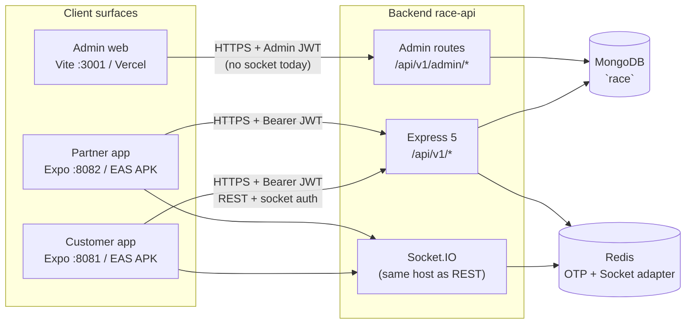

# RACE — Ecosystem QA & Preview Testing Playbook

> **Purpose:** Practical guide to test RACE as one connected product — customer app, partner app, admin web, backend API, and MongoDB — across local and cloud preview tiers.  
> **Audience:** QA, founders, and agents. Hindi labels where helpful (परीक्षण = testing, वातावरण = environment).  
> **Related:** [CLOUD_PRODUCTION_RUNBOOK.md](./CLOUD_PRODUCTION_RUNBOOK.md) · [MOCK_TESTING_PLAYBOOK.md](../MOCK_TESTING_PLAYBOOK.md) · [MVP_LOCAL_TESTING.md](../MVP_LOCAL_TESTING.md) · [DEVICE_FREE_PREVIEW.md](../DEVICE_FREE_PREVIEW.md)

**Last verified:** 2026-10-31 (Render `/health` → 200; routes/auth/socket read from repo)

---

## 1. Architecture communication map

All live surfaces share **one MongoDB database** (`race` on Atlas in cloud; `mongodb://…/race` locally). The backend is the only writer for business rules; apps are JWT clients + Socket.IO subscribers.

**Data models (booking duality — do not mix silently):**

| Model | Collection role | Used by |
|-------|-----------------|--------|
| `TowingBooking` | Towing + on-site roadside (`RSV-*`) | Customer create, vendor assign, admin list (towing filter) |
| `DriverBooking` | Driver hire (`DRV-*`) | Customer create, independent driver offers, admin list (driver filter) |
| Legacy `Booking` | Old admin seed / some KPI paths | Admin “Legacy” filter; may be empty while mobile bookings exist |

Customer-facing status is **masked** in API (`applyCustomerBookingView` / `bookingDisplayStatus`) — e.g. driver identity hidden until en route; `ASSIGNED` may show as searching until partner accepts.

---

## 2. Surface-by-surface reference

| Surface | Dev port | Cloud URL (preview/prod) | Auth | Key API families |
|---------|----------|---------------------------|------|------------------|
| **Backend API** | `3000` | `https://race-api-w361.onrender.com` | Mobile: `POST /api/v1/auth/send-otp`, `verify-otp` → JWT. Admin: `POST /api/v1/admin/auth/login` → admin JWT | See route table below |
| **Customer app** | Metro `8081` | EAS APK (`@webstarts/race-service`) | OTP → JWT in secure storage; socket sends same token | `/api/v1/profile`, `/vehicles`, `/bookings/towing`, `/bookings/driver`, `/bookings/roadside`, `/payments/*`, `/sos/*`, `/subscriptions/*` |
| **Partner app** | Metro `8082` | EAS `@webstarts/race-partners` (projectId in runbook) | OTP (+ optional driver password for vendor-managed); role `vendor` \| `driver` | `/api/v1/vendor/*`, `/api/v1/driver/*`, shared profile/notifications |
| **Admin web** | `3001` | `https://race-admin-six.vercel.app` | **Hardcoded platform admin** — `backend/src/config/hardcoded-admin.ts` (`ADMIN_EMAIL` / `ADMIN_PASSWORD` env). **Not** the Mongo `Admin` model | `/api/v1/admin/*` (customers, vendors, drivers, bookings, finance, reports, settings) |
| **MongoDB** | Docker `race-mongo` | Atlas (Render `MONGODB_URI`) | N/A — accessed only via API | DB name **`race`** |

**Default admin login (local + typical Render env):** `admin@raceservice.com` / `Admin@123` — confirm in `backend/.env` before testing.

**Mobile API base URL:**

- App config: `customer application/src/config/api.ts` — `EXPO_PUBLIC_API_URL` is host **without** `/api/v1`; paths add `/api/v1/...`.
- EAS **customer** `preview` + `production`: `https://race-api-w361.onrender.com`, `EXPO_PUBLIC_SKIP_OTP_AUTH=false`.
- EAS **partner** `production-test` / `production`: same Render URL, preview UI flags **off**. **`preview` profile turns on `EXPO_PUBLIC_UI_PREVIEW_*`** — not for real cross-app E2E.

**Admin API base:** `VITE_API_URL=https://race-api-w361.onrender.com/api/v1` (must include `/api/v1`).

### REST route map (backend `controller/src/index.ts`)

| Prefix | Purpose |
|--------|---------|
| `/health` | Liveness (no auth) |
| `/api/v1/auth/*` | OTP, refresh |
| `/api/v1/bookings/towing`, `/driver`, `/roadside` | Create/list/cancel/tracking per type |
| `/api/v1/bookings/*` | Combined customer booking helpers |
| `/api/v1/payments/*` | Advance/final — **stubs** when `ALLOW_STUB_PAYMENTS=true` |
| `/api/v1/vendor/*`, `/api/v1/driver/*` | Partner operations |
| `/api/v1/admin/*` | Admin panel |
| `/api/v1/qa-bootstrap/*` | Token-gated QA upsert/wipe (non-production only) |

### Real-time (Socket.IO)

- **Connect:** Same origin as `EXPO_PUBLIC_API_URL`; handshake **requires user JWT** (`socket.io` `auth.token` or `Authorization`). Admin tokens are rejected.
- **Rooms:** `user:{userId}`, `driver:{driverId}`, `booking:{bookingId}`, broadcast rooms `drivers:open-offers`, `vendors:open-offers`.
- **Client → server:** `driver:join`, `booking:track`.
- **Server → clients (main events):**

| Event | Typical listener |
|-------|------------------|
| `booking:status` | Customer (invalidate bookings), driver (refresh jobs) |
| `driver:location` | Customer live tracking (after `booking:track`) |
| `booking:driver_arrived_dropoff` | Customer drop-off payment prompt |
| `booking:payment_confirmed` | Driver |
| `job:offer` | Independent drivers (offer feed refresh) |
| `vendor:jobs-updated` | Vendor jobs list |
| `notification:new` | Customer + partner (inbox refresh) |
| `trip:otp` | Driver (trip OTP) |

Admin web **does not** subscribe to Socket.IO today — refresh lists manually or rely on polling.

---

## 3. Cross-surface test matrix

Use this as a monthly regression script. **Columns:** C = Customer app, P = Partner app, A = Admin, B = Backend/API (curl or logs), M = Mongo (optional spot-check).

| User journey | C | P | A | B | M | Notes |
|--------------|---|---|---|---|---|--------|
| OTP login (whitelist QA) | ✓ | ✓ | — | ✓ | — | Render: `9000000005` / `9000000001–04` often return `devOtp: 123456` when whitelist/Hanu dev path active. Real numbers → SMS. |
| OTP login (admin) | — | — | ✓ | ✓ | — | Hardcoded credentials only |
| Profile wizard / onboarding | ✓ | ✓ | ✓ | ✓ | ✓ | Admin sees new customer/vendor/driver after registration |
| Book instant towing (BBSR) | ✓ | — | ✓ | ✓ | ✓ | Serviceability gate server-side (`bookings/serviceability`) |
| Stub advance → CONFIRMED | ✓ | — | ✓ | ✓ | ✓ | Needs `ALLOW_STUB_PAYMENTS=true` on API |
| Vendor sees job + assigns driver | — | ✓ | ✓ | ✓ | ✓ | Socket `vendor:jobs-updated` |
| Driver accepts + trip OTP | — | ✓ | — | ✓ | ✓ | Location gate: manual/GPS rules on partner |
| Customer tracking + map | ✓ | — | — | ✓ | — | Join room via `booking:track`; poll fallback |
| Notifications (create + read) | ✓ | ✓ | — | ✓ | ✓ | Per-item `PATCH /:id/read` needs backend deploy if 404 |
| SOS alert | ✓ | — | — | ✓ | ✓ | **Gate:** vehicle + owner + emergency contact complete (`EmergencyAssistanceContent`) |
| Driver hire (DRV) | ✓ | ✓ | ✓ | ✓ | ✓ | Offers to matching independent drivers |
| Roadside on-site (RSV) | ✓ | ✓ | ✓ | ✓ | ✓ | Some catalog tiles still “Coming soon” in availability API |
| Admin assign / status override | — | — | ✓ | ✓ | ✓ | Prefer mobile-created bookings; know legacy `Booking` filter |
| Cancel + refund preview | ✓ | — | ✓ | ✓ | ✓ | Stub refund rules |
| Payment final (UPI/cash stub) | ✓ | ✓ | — | ✓ | — | No real Razorpay in MVP |

**Can you test end-to-end like a real customer across all surfaces?**

**Yes**, when:

1. All apps point at the **same API** (Render URL or local `:3000`).
2. Partner APK uses **`production-test`**, **`preview`**, or **`production`** (all point at Render with real API mutations; no UI mock flags).
3. Customer APK uses **`preview` or `production`** with `SKIP_OTP_AUTH=false`.
4. QA accounts exist in Atlas — run **`npm run ensure:test-accounts`** against Atlas URI once, or login **`9000000005`** and complete profile in-app.
5. You accept **stub payments** (Render needs `ALLOW_STUB_PAYMENTS=true`), **Render cold start** (first request 15–45s), and **admin refresh** without live sockets.

**Automated Tier-B gate:** `cd backend && npm run smoke:render` (hits live Render; safe read + one book/pay if customer has vehicle).

**Partial / no:**

- Admin will not see socket-driven updates instantly.
- Legacy admin KPIs tied to `Booking` may disagree with mobile collections until filtered to towing/driver.
- iOS TestFlight / Play Store production tracks are out of scope for this playbook.

---

## 4. Preview environments (2–3 tiers)

### Tier A — Local integrated (Codespace / laptop)

**Best for:** fast iteration, destructive DB tests, full Mongo control.

| Component | Command / URL |
|-----------|----------------|
| Mongo + Redis | `docker compose -f backend/docker-compose.yml up -d` |
| Backend | `cd backend && npm run dev` → `http://localhost:3000` |
| Customer | `cd "customer application" && EXPO_PUBLIC_API_URL=http://localhost:3000 npx expo start --port 8081` |
| Partner | `cd "mobile application" && EXPO_PUBLIC_API_URL=http://localhost:3000 npx expo start --port 8082` |
| Admin | `cd race-admin && VITE_API_URL=http://localhost:3000/api/v1 npm run dev` → `:3001` |

Set `TEST_OTP_WHITELIST`, `ALLOW_STUB_PAYMENTS=true`, `MOCK_DATA_MODE=false` per [MVP_LOCAL_TESTING.md](../MVP_LOCAL_TESTING.md).

**Browser-only mobile (no device):** Peach sim — [DEVICE_FREE_PREVIEW.md](../DEVICE_FREE_PREVIEW.md), [CUSTOMER_APP_PEACH_RUNBOOK.md](../CUSTOMER_APP_PEACH_RUNBOOK.md). Headless VMs may lack WebGL2; use API-level E2E if sim is blank.

### Tier B — Cloud preview stack (recommended monthly)

**Best for:** APK + admin + shared prod-like DB without shipping to stores.

| Layer | Service | URL / artifact |
|-------|---------|----------------|
| API | Render `race-api` | `https://race-api-w361.onrender.com` |
| Admin | Vercel `race-admin` | `https://race-admin-six.vercel.app` |
| Customer APK | EAS profile **`preview`** or **`production`** | Internal APK from [Expo builds](https://expo.dev/accounts/webstarts/projects/race-service/builds) |
| Partner APK | EAS profile **`production-test`** (not `preview`) | [Partner builds](https://expo.dev/accounts/webstarts/projects) |

**Build cadence (monthly suggestion):**

1. Merge to deploy branch (`v2.5.2-development` or team-agreed branch).
2. Wait for Render deploy → `curl -s https://race-api-w361.onrender.com/health`.
3. Confirm Vercel production alias serves latest bundle.
4. `eas build -p android --profile preview` (customer) + `--profile production-test` (partner).
5. Install both APKs on 2 physical devices (or one phone + one emulator).
6. Run **Section 3 matrix** top to bottom; log defects in GitHub issues.

**QA data on Render:**

- `POST /api/v1/qa-bootstrap/test-accounts` with header `x-qa-token` (requires `QA_BOOTSTRAP_TOKEN`, **disabled when `NODE_ENV=production`**).
- Local alternative: `npm run ensure:test-accounts` or `seed:test-accounts` (**destructive** — see seed guard).

### Tier C — Production-like / pilot

Same URLs as Tier B with stricter flags:

- `MOCK_DATA_MODE=false`, real HanuSMS for non-whitelist numbers.
- `EXPO_PUBLIC_SKIP_OTP_AUTH=false` on all shipped builds.
- `ALLOW_STUB_PAYMENTS=false` only when Razorpay keys and webhooks are configured (not MVP today).
- Monitor Render logs, optional Sentry (not wired in repo yet — placeholder in checklist).

---

## 5. Monthly crash & regression hunt

Run at the start of each month (or before each EAS build). **Prioritize:** auth → booking create → partner accept → tracking → payment stub → cancel.

### Automated gates (repo)

| Check | Command | Pass criterion |
|-------|---------|----------------|
| Backend types | `cd backend && npm run lint` | Exit 0 |
| Customer types | `cd "customer application" && npm run lint` | Exit 0 |
| Partner types | `cd "mobile application" && npm run lint` | Exit 0 |
| Admin types | `cd race-admin && npm run lint` | Exit 0 |
| Expo health | `npx expo-doctor` in each app folder | 21/21 |
| Backend audit script | `cd backend && npm run seed:fresh && tsx src/scripts/comprehensive-audit.ts` | **Local only** — creates test data; purge after. Do **not** run `seed:fresh` on shared Atlas without approval. |
| API smoke | `curl -s -o /dev/null -w "%{http_code}" https://race-api-w361.onrender.com/health` | `200` |

### Manual / device checks

| Area | Method | What to watch |
|------|--------|----------------|
| **Cold start** | First API call after 15+ min idle on Render | Timeouts — apps use 30–45s axios timeout; retry once |
| **OTP** | Whitelist + one real number | Wrong code rejected; no client-side magic OTP when preview flags off |
| **Maps** | Towing pickup + live track | Blank tiles → missing `EXPO_PUBLIC_GOOGLE_MAPS_KEY` on EAS env (customer fixed; **verify partner EAS**) |
| **Payments** | Advance + drop-off | Stub only; document “paid” vs gateway |
| **Sockets** | Active booking | Customer inbox/bookings refresh on status change without kill/restart |
| **Peach / sim limits** | Browser sim | WebGL2 failures on headless — not an APK blocker |
| **Logcat / adb** | `adb logcat \| grep -i fatal` during flows | Native crashes, OOM, Maps |
| **Sentry** | *(placeholder)* | Wire before Tier C pilot |

### Prioritization rubric

1. **P0 — Crash or data loss:** app exit, 500 on book/pay, JWT loop, booking stuck paid-but-PENDING.
2. **P1 — Broken journey:** cannot assign driver, tracking empty, admin list missing mobile bookings.
3. **P2 — Wrong UX copy/status:** customer sees driver too early, misleading “Confirmed”.
4. **P3 — Polish:** skeleton flicker, date format, empty states.

Fix loop: reproduce on Tier B → patch on active branch → re-run one matrix row → full matrix before closing.

---

## 6. “Can I build APKs and test with admin?” (explicit)

| Question | Answer | Prerequisites |
|----------|--------|----------------|
| Customer APK → Render API → same bookings admin sees? | **YES** | EAS `preview`/`production`; `EXPO_PUBLIC_API_URL` = Render; Atlas shared with Render |
| Partner APK → accept jobs from those bookings? | **YES** | Use **`production-test`** profile; QA vendor `9000000001` or real approved vendor |
| Admin login while testing APKs? | **YES** | Browser → Vercel alias; same API |
| Customer + partner + admin without cloud? | **YES** | Tier A local stack |
| Real Razorpay in APK? | **NO (today)** | Stubs only — `ALLOW_STUB_PAYMENTS` |
| EAS `preview` partner APK for real E2E? | **YES** | Same Render URL + preview flags off (as of 2026-10-31); prefer **`production-test`** if you want identical env to field APK |
| Play Store submit from this doc? | **Out of scope** | Partner `production` = AAB; needs `google-services.json` for **submit**, not for sideload APK |
| Maps on release APK? | **YES if** | `EXPO_PUBLIC_GOOGLE_MAPS_KEY` set in EAS env for that profile |
| iOS? | **Not in cloud cut** | Android APK focus per runbook |

---

## 7. QA accounts & bootstrap (verified sources)

**Preferred cloud QA (non-destructive upsert):** numbers `9000000001`–`9000000004` — vendor, FT driver, PT driver, vendor-managed driver. See `backend/src/services/src/qaAccounts.ts` and `backend/src/scripts/ensure-test-accounts.ts`.

**Customer testing:** `9000000005` documented for full wizard + Render E2E; whitelist numbers use OTP **`123456`** when `TEST_OTP_WHITELIST` matches (dev/Render non-prod behavior — confirm env on service).

**Legacy mock playbook numbers** (`9876543299`, `8888880001`, …) apply only after `npm run seed:mock` — **avoid on shared Atlas**; see seed guard in `backend/src/database/src/seed-guard.ts`.

**Admin:** always platform hardcoded admin, not seeded Mongo users.

---

## 8. Known gaps (use when triaging failures)

From recent audits and current tree — not blockers for Tier B demo, but explain “false failures”:

| Gap | Symptom | Workaround |
|-----|---------|------------|
| **Payments stub** | Always “success” on verify | Treat as demo; no card/UPI gateway |
| **Roadside catalog** | Some services `available: false` | Test on-site assist / enabled SKUs only |
| **Legacy `Booking` admin filter** | Empty “Legacy” while mobile has trips | Filter **Towing** / **Driver** |
| **SOS completeness gate** | SOS / More help blocked | Profile → SOS Details: vehicle, owner, emergency contact |
| **Partner notification prefs UI** | Removed from partner Profile | Backend prefs may still exist; no in-app editor |
| **Per-notification read API** | Partner/customer mark-one 404 on old API | Deploy backend with `PATCH .../:id/read` or use mark-all |
| **Render spin-down** | Network error on first tap | Open `/health` once; retry login |
| **Customer assign/accept UX** | “Partner accepting” vs raw `ASSIGNED` | Expected — backend masks status for customer |
| **Sentry / crash reporting** | No automatic crash upload | adb logcat + manual repro |
| **Partner EAS maps key** | Partner release map blank | Mirror customer EAS secret setup |
| **MOCK_TESTING_PLAYBOOK credentials** | Don’t match Atlas after purge | Use QA bootstrap accounts above |

---

## 9. Quick start checklist (one afternoon)

1. Warm API: `curl https://race-api-w361.onrender.com/health`
2. Admin: open Vercel URL → login → note dashboard counts
3. Install customer + partner APKs (Tier B profiles)
4. Customer: login `9000000005` → book towing in Bhubaneswar → pay stub advance
5. Partner vendor `9000000001`: assign driver `9000000002` or `9000000004`
6. Driver: accept, progress trip, complete drop-off flow
7. Admin: refresh bookings → same ID and status
8. Customer: tracking + notifications + cancel preview on a **second** test book

---

## 10. Document maintenance

Update this file when:

- Render/Vercel/EAS URLs or project IDs change
- New socket events or admin routes ship
- OTP or payment policy changes (stub → live gateway)
- Booking model strategy merges legacy `Booking`

**Do not commit secrets.** Reference env **names** only.
